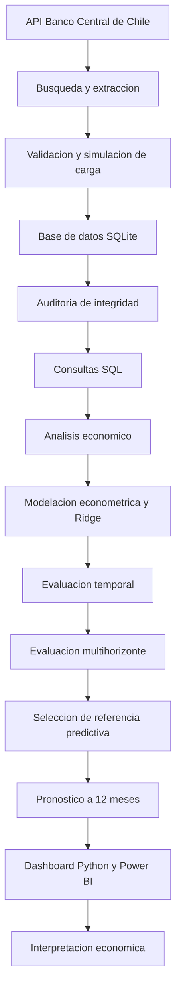

# Grupo 2 — Proyección de la tasa de desempleo en Chile

Proyecto del curso **Ciencia de Datos para Economía (ICO09425)**.

El objetivo del proyecto es construir un monitor de coyuntura económica y evaluar la capacidad predictiva de distintos indicadores macroeconómicos para proyectar la **tasa de desempleo nacional de Chile durante los próximos 12 meses**.

El proyecto integra extracción programática de datos, almacenamiento relacional, consultas SQL, análisis económico, modelación econométrica, aprendizaje automático y visualización de resultados.

## 1. Variable objetivo y pregunta de investigación

La variable objetivo es la **tasa de desempleo nacional de Chile**.

La pregunta de investigación es:

> ¿Cómo evolucionará la tasa de desempleo nacional durante los próximos 12 meses y qué capacidad predictiva tienen los indicadores de actividad económica, mercado laboral, política monetaria y condiciones externas para anticipar su trayectoria?

Los objetivos específicos son:

- Construir una base de datos de indicadores macroeconómicos.
- Analizar la evolución del mercado laboral chileno.
- Estudiar las relaciones temporales entre actividad económica y desempleo.
- Evaluar distintos modelos de pronóstico.
- Comparar su desempeño frente a un benchmark ingenuo.
- Generar una proyección a 12 meses incorporando medidas de incertidumbre.
- Comunicar los resultados mediante visualizaciones y un monitor de coyuntura.

## 2. Fuente de datos

Los datos provienen de la **Base de Datos Estadísticos (BDE) del Banco Central de Chile**, mediante la API Siete.

La tasa de desocupación corresponde a información del Instituto Nacional de Estadísticas (INE), disponible a través de la BDE.

Fuentes institucionales:

- Banco Central de Chile: https://www.bcentral.cl/
- Base de Datos Estadísticos: https://si3.bcentral.cl/Siete
- Instituto Nacional de Estadísticas: https://www.ine.gob.cl/

El catálogo de indicadores se encuentra en:

`src/config.py`

Cada indicador contiene su código de identificación, nombre, categoría temática, unidad, fecha inicial y justificación económica.

### Series económicas utilizadas

| Indicador | Frecuencia | Unidad registrada |
|---|---|---|
| Tasa de desempleo nacional | Mensual | Porcentaje |
| IMACEC total | Mensual | Índice 2018=100 |
| Personas ocupadas | Mensual | Miles de personas |
| Fuerza de trabajo nacional | Mensual | Miles de personas |
| Población de 15 años y más | Mensual | Miles de personas |
| Índice de Avisos Laborales de Internet (IALI) | Mensual | Índice 2018=100 |
| Índice de Producción Manufacturera | Mensual | Índice 2018=100 |
| Inflación IPC anual | Mensual | Porcentaje |
| Tasa de Política Monetaria (TPM) | Mensual | Porcentaje |
| Precio del cobre refinado BML | Mensual | USD por libra |
| Tipo de cambio observado | Mensual | CLP por USD |
| PIB total real | Trimestral | Miles de millones de pesos encadenados |

La tasa de desempleo utilizada corresponde a la serie original no ajustada estacionalmente:

`F049.DES.TAS.INE9.10.M`

El IMACEC corresponde a la serie original empalmada, con referencia 2018:

`F032.IMC.IND.Z.Z.EP18.Z.Z.0.M`

La tasa de desempleo se publica con frecuencia mensual y representa trimestres móviles, por lo que existe superposición entre observaciones consecutivas.

### Muestra utilizada

La base de datos de referencia contiene:

- 12 series económicas.
- 2.167 observaciones totales.
- 198 observaciones de la tasa de desempleo nacional.
- Período de la variable objetivo: marzo de 2010 a agosto de 2026.
- Última tasa de desempleo observada: 9,6403%.

Las series poseen distintas fechas iniciales y finales según su disponibilidad.

La fecha de corte utilizada para probar el procedimiento de actualización de datos es:

`2026-09-30`

Esta fecha corresponde al período observado solicitado y no necesariamente a la fecha de publicación de cada indicador.

La actualización fue validada sobre una copia temporal de la base de datos. Los resultados de modelación documentados en este README corresponden a la base original, cuya variable objetivo finaliza en agosto de 2026.

## 3. Requisitos

El entorno utilizado para desarrollar y validar el proyecto corresponde a:

**Python 3.11.9**

También se requiere:

- Acceso a internet.
- Token de acceso a la API Siete.
- Git.
- Dependencias definidas en `requirements.txt`.

Las versiones de las dependencias directas utilizadas se encuentran fijadas para mejorar la reproducibilidad del proyecto.

| Biblioteca | Versión |
|---|---|
| bcchapi | 1.3.0 |
| python-dotenv | 1.2.4 |
| pandas | 3.0.6 |
| numpy | 2.4.6 |
| matplotlib | 3.11.2 |
| seaborn | 0.13.2 |
| statsmodels | 0.15.0 |
| scipy | 1.17.1 |
| jupyter | 1.1.1 |
| scikit-learn | 1.9.1 |

SQLite se utiliza mediante el módulo `sqlite3`, incluido en la biblioteca estándar de Python.

## 4. Instalación

Clonar el repositorio:

```bash
git clone https://github.com/Alonso-Castillo/Grupo2-Tasa-de-desempleo.git
cd Grupo2-Tasa-de-desempleo
```

Para acceder a las correcciones del Hito 3, mientras estas se encuentren en su rama de desarrollo:

```bash
git switch correcciones-hito3
```

### Windows

Crear un entorno virtual con Python 3.11:

```powershell
py -3.11 -m venv .venv
```

Activarlo desde PowerShell:

```powershell
.venv\Scripts\Activate.ps1
```

Alternativamente, desde CMD:

```cmd
.venv\Scripts\activate.bat
```

Instalar las dependencias:

```powershell
python -m pip install --upgrade pip
python -m pip install -r requirements.txt
```

### macOS / Linux

Crear y activar el entorno virtual:

```bash
python3.11 -m venv .venv
source .venv/bin/activate
```

Instalar las dependencias:

```bash
python -m pip install --upgrade pip
python -m pip install -r requirements.txt
```

Verificar la instalación:

```bash
python --version
python -m pip check
```

## 5. Credenciales

Para acceder a la API Siete del Banco Central de Chile:

1. Obtener un token personal de acceso.
2. Copiar el archivo `.env.example`.
3. Renombrar la copia como `.env`.
4. Reemplazar el valor de ejemplo por el token personal.

El archivo debe tener la siguiente estructura:

```text
BCCH_API_TOKEN=PEGA_AQUI_TU_TOKEN
```

Cada integrante debe configurar sus propias credenciales.

El archivo `.env` nunca debe incorporarse al repositorio.

## 6. Extracción programática de datos

### Búsqueda de series económicas

El script:

`extraccion/buscar_series.py`

permite consultar el catálogo de series económicas del Banco Central de Chile utilizando términos de búsqueda.

Ejemplo:

```bash
python extraccion/buscar_series.py "desocupación" --limite 100
```

También permite filtrar por frecuencia:

```bash
python extraccion/buscar_series.py "IMACEC" --frecuencia M --limite 30
```

Para exportar las coincidencias:

```bash
python extraccion/buscar_series.py "IMACEC" --frecuencia MONTHLY --limite 30 --exportar
```

El archivo generado se almacena en:

`resultados/busqueda_series_bcch.csv`

La búsqueda permite identificar códigos, nombres oficiales, frecuencias y disponibilidad temporal de las series.

Este procedimiento no descarga las observaciones ni modifica la base SQLite.

### Verificación de observaciones

El script:

`extraccion/descargar_series.py`

permite descargar las observaciones de desempleo e IMACEC y contrastarlas con los datos almacenados localmente.

```bash
python extraccion/descargar_series.py
```

La comparación utiliza una tolerancia numérica de 1e-6.

Resultados obtenidos para la muestra de referencia:

| Indicador | Observaciones | Coincidentes | Diferencias |
|---|---:|---:|---:|
| Desempleo nacional | 198 | 198 | 0 |
| IMACEC total | 200 | 192 | 8 |

La diferencia absoluta máxima observada para el IMACEC fue de aproximadamente 0,447825 puntos del índice.

Las diferencias se concentran entre enero y agosto de 2026 y son compatibles con posibles revisiones de las estadísticas económicas.

La existencia de diferencias no permite determinar automáticamente si corresponden a revisiones oficiales, cambios de precisión o discrepancias en la carga original.

La verificación no modifica los datos almacenados localmente.

## 7. Base de datos relacional

El proyecto utiliza SQLite para almacenar y organizar las series económicas.

La base contiene tres tablas:

### Tabla `temas`

Almacena las categorías económicas.

- `id_tema`: clave primaria.
- `tema`: nombre de la categoría.
- `descripcion`: descripción de la categoría.

### Tabla `series`

Almacena los metadatos de cada indicador.

- `id_serie`: clave primaria.
- `nombre`: nombre del indicador.
- `fuente`: institución de origen.
- `frecuencia`: frecuencia de observación.
- `unidad`: unidad de medida.
- `id_tema`: clave foránea.

### Tabla `observaciones`

Almacena los valores históricos.

- `id_serie`: identificador de la serie.
- `fecha`: fecha de observación.
- `valor`: valor numérico.

La clave primaria compuesta por `id_serie` y `fecha` evita almacenar más de una observación para una misma serie y fecha.

La estructura relacional es:

```text
temas
  |
  | 1:N
  v
series
  |
  | 1:N
  v
observaciones
```

### Creación de la base

```bash
python base_datos/crear_base.py
```

La base se genera localmente en:

`base_datos/desempleo_chile.db`

## 8. Carga segura y actualización de datos

### Verificar disponibilidad de la API

```bash
python base_datos/probar_api.py --hasta 2026-09-30
```

### Simular una actualización

```bash
python base_datos/cargar_series.py --hasta 2026-09-30 --simular
```

El modo de simulación es el comportamiento predeterminado del script.

Este procedimiento descarga y valida las series, compara las observaciones con SQLite e identifica:

- Observaciones coincidentes.
- Observaciones nuevas.
- Revisiones o diferencias históricas.
- Diferencias numéricas menores.
- Observaciones posteriores al corte.
- Observaciones locales no devueltas por la API.

La simulación no modifica la base de datos.

### Aplicar una actualización

Únicamente después de revisar los resultados de la simulación:

```bash
python base_datos/cargar_series.py --hasta 2026-09-30 --aplicar
```

El modo de aplicación autoriza la escritura en SQLite y la actualización de valores históricos.

El procedimiento incorpora:

- Validación previa de las series.
- Respaldo de la base existente.
- Registro de cambios propuestos.
- Control de integridad.
- Escritura de las series en una única transacción.
- Reversión de cambios ante errores durante la transacción.

La eliminación de observaciones posteriores al corte requiere autorización explícita mediante `--permitir-recorte`.

Esta opción no debe utilizarse sin revisar previamente las consecuencias del recorte.

### Validación del procedimiento

El mecanismo de actualización fue probado en una copia temporal de la base original.

Resultados de la prueba:

| Control | Resultado |
|---|---|
| Series cargadas | 12 |
| Observaciones de la copia actualizada | 2.174 |
| Código de salida | 0 |
| Integridad SQLite | OK |
| Violaciones de claves foráneas | 0 |
| Modificación de la base original | No |

La conservación de la base original fue comprobada comparando su hash SHA-256 antes y después de las pruebas.

### Consideración sobre la TPM

La tasa de política monetaria mensual se obtiene mediante el promedio de las observaciones diarias disponibles de la serie correspondiente.

Las diferencias respecto de los valores mensuales almacenados originalmente pueden estar asociadas al redondeo o al procedimiento de agregación.

El procedimiento no certifica la cobertura completa de las observaciones diarias.

## 9. Auditoría de integridad y calidad

La auditoría de datos puede ejecutarse mediante:

```bash
python base_datos/auditar_integridad.py
```

El procedimiento verifica:

- Integridad interna de SQLite.
- Violaciones de claves foráneas.
- Observaciones duplicadas.
- Datos nulos.
- Observaciones sin serie asociada.
- Valores no numéricos.
- Valores infinitos o no convertibles.
- Identificadores duplicados.
- Series sin observaciones.
- Fechas inválidas.
- Continuidad temporal según la frecuencia.
- Valores fuera de los rangos definidos.
- Disponibilidad de metadatos.

### Resultados de la auditoría

La base original contiene 12 series y 2.167 observaciones.

| Comprobación | Incidencias |
|---|---:|
| Integridad SQLite | 0 |
| Violaciones de claves foráneas | 0 |
| Observaciones duplicadas | 0 |
| Observaciones con datos nulos | 0 |
| Observaciones sin serie asociada | 0 |
| Valores almacenados como no numéricos | 0 |
| Fechas inválidas o ausentes | 0 |
| Series con incidencias | 0 |

Los controles internos de integridad fueron superados.

Los resultados se almacenan en:

- `resultados/auditoria_integridad_general.csv`
- `resultados/auditoria_integridad_series.csv`

La ausencia de incidencias internas no certifica por sí sola la exactitud de los datos originales.

La continuidad temporal se comprueba entre la primera y la última fecha disponible de cada serie.

## 10. Consultas SQL

Las consultas se encuentran en:

`sql/`

Incluyen:

- Consultas relacionales mediante JOIN.
- Agregaciones mediante GROUP BY.
- Funciones de ventana.
- Variaciones interanuales.
- Rezagos temporales.
- Análisis del mercado laboral.
- Actividad económica.
- Inflación y política monetaria.
- Sector externo.
- PIB trimestral.

Las funciones de ventana se calculan separando las series mediante PARTITION BY cuando corresponde.

Las consultas permiten transformar los datos almacenados en información útil para el análisis económico.

## 11. Análisis de coyuntura económica

Los scripts de la carpeta:

`analisis/`

permiten estudiar la evolución de los indicadores macroeconómicos y sus relaciones con la tasa de desempleo.

El análisis considera:

- Evolución del mercado laboral.
- Tasa de participación laboral.
- Actividad económica.
- Producción manufacturera.
- Inflación y política monetaria.
- Precio del cobre.
- Tipo de cambio.
- PIB trimestral.
- Correlaciones contemporáneas y rezagadas.

Las relaciones observadas entre indicadores se interpretan como asociaciones económicas y predictivas, no como evidencia de causalidad.

## 12. Modelación econométrica

### Estacionariedad

Ejecutar:

```bash
python modelos/estacionariedad_desempleo.py
```

La prueba de Dickey-Fuller aumentada (ADF) permite evaluar la presencia de raíces unitarias en la tasa de desempleo.

Los resultados del análisis respaldan el uso de una primera diferencia de la serie, lo que fundamenta la integración de orden 1 en las especificaciones ARIMA consideradas.

### Funciones ACF y PACF

Ejecutar:

```bash
python modelos/acf_pacf_desempleo.py
```

Las funciones de autocorrelación y autocorrelación parcial permiten estudiar la estructura temporal de la serie diferenciada y orientar la identificación de modelos candidatos.

### Especificaciones ARIMA

Se consideran dos especificaciones:

- ARIMA(1,1,1): modelo econométrico original.
- ARIMA(0,1,2): modelo econométrico alternativo.

La incorporación de ARIMA(0,1,2) se fundamenta en los diagnósticos realizados sobre la muestra de entrenamiento anterior a 2024.

El modelo puede expresarse como:

$$
\Delta y_t =
\varepsilon_t
+ \theta_1 \varepsilon_{t-1}
+ \theta_2 \varepsilon_{t-2}
$$

Donde:

- $y_t$ representa la tasa de desempleo.
- $\Delta y_t$ corresponde a su primera diferencia.
- $\varepsilon_t$ representa una innovación aleatoria.
- $\theta_1$ y $\theta_2$ corresponden a los coeficientes de media móvil.

### Benchmark ingenuo

El benchmark ingenuo utiliza la última observación disponible como pronóstico para los horizontes futuros.

$$
\hat{y}_{t+h|t}=y_t
$$

Este modelo permite determinar si las especificaciones más complejas aportan capacidad predictiva adicional respecto de una referencia simple.

### Modelo Ridge

Se incorpora una regresión Ridge con predictores macroeconómicos rezagados.

La regularización Ridge penaliza la magnitud de los coeficientes para controlar la complejidad del modelo.

La optimización se ejecuta mediante:

```bash
python modelos/optimizar_ridge.py
```

La configuración utilizada en la evaluación comparativa actual corresponde a:

- Predictores: todos los predictores considerados en la configuración seleccionada.
- Alpha: 1,0.
- Rezago del IMACEC: dos meses.

El modelo Ridge se mantiene como alternativa de aprendizaje automático.

Su incorporación no implica que deba utilizarse como modelo de pronóstico final si su desempeño predictivo resulta inferior.

## 13. Evaluación temporal comparativa

Ejecutar:

```bash
python modelos/evaluacion_comparativa.py
```

La evaluación utiliza orígenes temporales sucesivos, ajustando los modelos con información histórica hasta cada origen de pronóstico.

El período de evaluación a un mes comprende:

`2024-01` a `2026-08`

La comparación utiliza 32 pronósticos por modelo.

Las métricas utilizadas son:

- RMSE: raíz del error cuadrático medio.
- MAE: error absoluto medio.
- Sesgo: error medio con signo.
- Mejora porcentual del RMSE respecto del benchmark.

El RMSE y el MAE se expresan en puntos porcentuales de la tasa de desempleo.

### Resultados a un mes

| Modelo | Pronósticos | RMSE | MAE | Sesgo | Mejora RMSE |
|---|---:|---:|---:|---:|---:|
| ARIMA(0,1,2) | 32 | 0,1755 | 0,1394 | -0,0236 | 19,49% |
| ARIMA(1,1,1) | 32 | 0,2076 | 0,1583 | -0,0240 | 4,78% |
| Benchmark ingenuo | 32 | 0,2180 | 0,1724 | -0,0364 | 0,00% |
| Ridge alpha 1 | 32 | 1,2985 | 1,1219 | 1,0983 | -495,69% |

ARIMA(0,1,2) presenta el menor RMSE y MAE a un mes.

En comparación con el benchmark ingenuo, reduce el RMSE en aproximadamente un 19,49%.

El modelo Ridge presenta un desempeño inferior a las alternativas temporales en el período evaluado.

Los resultados no permiten concluir que un modelo sea universalmente superior ni extrapolar automáticamente su desempeño a otros horizontes.

## 14. Evaluación multihorizonte

Ejecutar:

```bash
python modelos/evaluacion_multihorizonte.py
```

La evaluación considera horizontes de:

- 1 mes.
- 3 meses.
- 6 meses.
- 12 meses.

Los modelos comparados son:

- Benchmark ingenuo.
- ARIMA(0,1,2).
- ARIMA(1,1,1).

Los modelos se comparan utilizando las mismas observaciones disponibles dentro de cada horizonte.

### Resultados por horizonte

| Horizonte | Pronósticos por modelo | Benchmark RMSE | ARIMA(0,1,2) RMSE | ARIMA(1,1,1) RMSE |
|---|---:|---:|---:|---:|
| 1 mes | 32 | 0,2180 | 0,1755 | 0,2076 |
| 3 meses | 30 | 0,4897 | 0,4962 | 0,5273 |
| 6 meses | 27 | 0,6381 | 0,6938 | 0,7391 |
| 12 meses | 21 | 0,4337 | 0,5230 | 0,5338 |

ARIMA(0,1,2) obtiene el menor RMSE a un mes.

El benchmark ingenuo obtiene el menor RMSE a tres, seis y doce meses.

Las cantidades de pronósticos difieren entre horizontes debido a la disponibilidad de observaciones futuras para calcular los errores.

Por esta razón, las métricas deben compararse principalmente entre modelos dentro de un mismo horizonte.

### Resultados específicos a 12 meses

| Modelo | RMSE | MAE | Sesgo | Mejora RMSE |
|---|---:|---:|---:|---:|
| Benchmark ingenuo | 0,4337 | 0,3403 | -0,1785 | 0,00% |
| ARIMA(0,1,2) | 0,5230 | 0,4136 | -0,1899 | -20,58% |
| ARIMA(1,1,1) | 0,5338 | 0,4251 | -0,1899 | -23,08% |

Considerando que el objetivo principal del proyecto es proyectar el desempleo a 12 meses, se utiliza el benchmark ingenuo como referencia central.

ARIMA(0,1,2) se mantiene como alternativa econométrica complementaria.

Esta decisión se fundamenta en el desempeño retrospectivo observado en el horizonte de interés y no exclusivamente en la complejidad estadística de los modelos.

Los resultados se encuentran en:

- `resultados/predicciones_multihorizonte.csv`
- `resultados/metricas_multihorizonte.csv`
- `resultados/convergencia_multihorizonte.csv`
- `graficos/18_evaluacion_multihorizonte.png`

## 15. Control de convergencia y diagnóstico econométrico

Durante la estimación de modelos ARIMA se verifica que los procedimientos de optimización converjan correctamente.

Cuando el optimizador inicial presenta problemas de convergencia, se realiza un nuevo intento mediante el método Powell.

En la evaluación multihorizonte se obtuvieron:

- 64 ajustes de modelos ARIMA.
- 0 ajustes finales sin convergencia.

El ajuste de ARIMA(0,1,2) correspondiente al origen de julio de 2025 requirió un segundo procedimiento de optimización.

La convergencia fue recuperada correctamente.

### Diagnóstico de residuos

Ejecutar:

```bash
python modelos/diagnostico_arima_012.py
```

Se analiza el modelo ARIMA(0,1,2) en dos muestras:

- Entrenamiento anterior a 2024.
- Muestra completa disponible.

El diagnóstico incorpora:

- Coeficientes estimados.
- Errores estándar.
- P-valores.
- Criterios AIC y BIC.
- Invertibilidad del componente MA.
- Funciones de autocorrelación residual.
- Prueba de Ljung-Box.

### Resultados de Ljung-Box

| Muestra | Rezago 6 | Rezago 12 | Rezago 24 |
|---|---:|---:|---:|
| Entrenamiento anterior a 2024 | 0,215130 | 0,163791 | 0,054253 |
| Muestra completa | 0,145713 | 0,087082 | 0,018682 |

Los valores corresponden a los p-valores de la prueba.

En la muestra de entrenamiento anterior a 2024 no se rechaza la hipótesis nula de ausencia de autocorrelación conjunta hasta los rezagos evaluados, utilizando un nivel de significancia del 5%.

Sin embargo, en la muestra completa se rechaza la hipótesis nula al evaluar hasta el rezago 24.

Este resultado indica que la especificación ARIMA(0,1,2) no captura completamente toda la dependencia temporal de la serie.

No rechazar la hipótesis nula tampoco demuestra que los residuos sean perfectamente ruido blanco.

El componente MA cumple la condición de invertibilidad en ambas muestras.

### Parámetros estimados en la muestra completa

| Parámetro | Estimación |
|---|---:|
| MA(1) | 0,610234 |
| MA(2) | 0,632366 |
| Varianza de las innovaciones | 0,059105 |

Criterios de información:

- AIC: 9,0402.
- BIC: 18,8898.

Los resultados se almacenan en:

- `resultados/diagnostico_residuos_arima_012.csv`
- `resultados/coeficientes_arima_012.csv`
- `graficos/19_diagnostico_residuos_arima_012.png`

## 16. Pronóstico a 12 meses

El script principal de modelación es:

```bash
python modelos/modelos_desempleo.py
```

La proyección se construye utilizando la información disponible hasta agosto de 2026 en la serie objetivo.

El horizonte de pronóstico comprende:

`2026-09` a `2027-08`

### Pronóstico para agosto de 2027

| Modelo | Tasa proyectada |
|---|---:|
| Benchmark ingenuo | 9,6403% |
| ARIMA(0,1,2) | 9,8128% |
| ARIMA(1,1,1) | 9,7744% |

El benchmark ingenuo constituye la referencia central debido a su menor RMSE observado en la evaluación retrospectiva a 12 meses.

ARIMA(0,1,2) se presenta como alternativa econométrica complementaria.

### Intervalos de predicción al 95%

| Modelo | Límite inferior | Pronóstico | Límite superior |
|---|---:|---:|---:|
| Benchmark ingenuo | 7,5275% | 9,6403% | 11,7531% |
| ARIMA(0,1,2) | 6,3149% | 9,8128% | 13,3106% |

Los intervalos del benchmark se construyen bajo el supuesto de una caminata aleatoria sin deriva.

Los intervalos ARIMA corresponden a la incertidumbre de predicción estimada bajo los supuestos del modelo.

Los intervalos no representan límites garantizados de la evolución futura del desempleo.

El archivo principal de pronóstico se encuentra en:

`resultados/pronostico_desempleo_12m.csv`

El gráfico correspondiente se encuentra en:

`graficos/13_pronostico_12_meses.png`

## 17. Interpretación económica

El escenario central proyecta una tasa de desempleo relativamente estable durante el horizonte analizado.

El benchmark mantiene el último valor observado, mientras que ARIMA(0,1,2) proyecta un aumento inicial moderado seguido de una estabilización.

El aumento de la amplitud de los intervalos de predicción refleja la mayor incertidumbre asociada a horizontes más alejados.

La estabilidad proyectada por estos modelos no implica que la tasa de desempleo permanecerá necesariamente constante.

La evolución futura dependerá de factores como:

- Crecimiento de la actividad económica.
- Creación de empleo.
- Participación laboral.
- Condiciones monetarias.
- Demanda interna.
- Condiciones económicas internacionales.

La interpretación económica detallada se desarrolla en:

`informes/interpretacion_pronostico.md`

## 18. Limitaciones metodológicas

Los resultados deben interpretarse considerando las siguientes limitaciones:

### Evaluación retrospectiva

La evaluación utiliza series históricas disponibles actualmente.

No corresponde a una evaluación completamente inexplorada ni a un ejercicio realizado con versiones de datos disponibles estrictamente en tiempo real.

### Revisiones estadísticas

Algunos indicadores macroeconómicos presentan revisiones históricas.

Una descarga posterior desde la API puede devolver valores distintos de los utilizados originalmente.

La fecha de corte de observación no reconstruye automáticamente las versiones históricas de los datos.

### Disponibilidad de información

Las series poseen diferentes calendarios de publicación.

La utilización de rezagos permite aproximar restricciones de disponibilidad, pero no garantiza por sí sola que toda la información hubiera estado publicada en cada fecha de pronóstico histórica.

### Trimestres móviles

La tasa de desempleo se encuentra disponible mensualmente, pero corresponde a trimestres móviles.

La superposición de observaciones consecutivas puede generar dependencia temporal adicional.

### Diagnóstico de residuos

El modelo ARIMA(0,1,2) presenta evidencia de autocorrelación residual en la muestra completa al evaluar hasta el rezago 24.

Por lo tanto, no se considera una representación exhaustiva de la dinámica del desempleo.

### Incertidumbre y tamaño muestral

La evaluación a 12 meses dispone de 21 pronósticos por modelo.

Además, los errores de pronósticos multihorizonte pueden presentar dependencia debido a la superposición de sus períodos.

Las diferencias en las métricas constituyen evidencia descriptiva del desempeño observado y no demuestran necesariamente superioridad estadísticamente significativa.

### Alcance del modelo Ridge

El modelo Ridge se evalúa a un mes.

No se utiliza como referencia principal a 12 meses porque no se ha validado comparativamente su desempeño para ese horizonte.

### Interpretación causal

Las asociaciones entre indicadores económicos y desempleo no deben interpretarse como relaciones causales.

## 19. Dashboard reproducible en Python

El proyecto incorpora un monitor gráfico desarrollado en Python.

```bash
python dashboard/dashboard_desempleo.py
```

El archivo se genera en:

`dashboard/dashboard_desempleo.png`

El dashboard utiliza información proveniente de SQLite y de los resultados de modelación.

Su actualización debe mantener coherencia con:

- La última observación de la variable objetivo.
- La evaluación comparativa a un mes.
- La evaluación multihorizonte.
- El benchmark como referencia central a 12 meses.
- ARIMA(0,1,2) como alternativa econométrica.
- Los intervalos de predicción correspondientes.

La adaptación del dashboard a los resultados actualizados forma parte de la consolidación final del proyecto.

## 20. Monitor en Power BI

El proyecto incluye un monitor de coyuntura desarrollado en Power BI.

Las visualizaciones consideran:

- Evolución histórica del desempleo.
- Indicadores macroeconómicos.
- Evaluación comparativa de modelos.
- Pronóstico a 12 meses.
- Benchmark de referencia.
- Intervalos de predicción.

La versión final debe utilizar los resultados actualizados de los scripts de Python.

La sincronización de Power BI con las nuevas especificaciones y métricas se encuentra pendiente de validación final.

## 21. Estructura del proyecto

```text
Grupo2-Tasa-de-desempleo/
|
|-- analisis/
|   |-- Scripts de analisis economico
|   |-- Scripts de coyuntura
|   `-- Scripts de visualizacion
|
|-- base_datos/
|   |-- crear_base.py
|   |-- cargar_series.py
|   |-- cargar_desempleo.py
|   |-- probar_api.py
|   |-- verificar_base.py
|   `-- auditar_integridad.py
|
|-- dashboard/
|   |-- dashboard_desempleo.py
|   `-- dashboard_desempleo.png
|
|-- extraccion/
|   |-- buscar_series.py
|   `-- descargar_series.py
|
|-- graficos/
|   `-- Visualizaciones generadas
|
|-- informes/
|   `-- interpretacion_pronostico.md
|
|-- modelos/
|   |-- estacionariedad_desempleo.py
|   |-- acf_pacf_desempleo.py
|   |-- optimizar_ridge.py
|   |-- evaluacion_comparativa.py
|   |-- evaluacion_multihorizonte.py
|   |-- diagnostico_arima_012.py
|   `-- modelos_desempleo.py
|
|-- resultados/
|   |-- Archivos de auditoria
|   |-- Metricas de evaluacion
|   |-- Predicciones fuera de muestra
|   |-- Diagnosticos econometricos
|   `-- Pronostico a 12 meses
|
|-- sql/
|   `-- Consultas SQL
|
|-- src/
|   `-- config.py
|
|-- .env.example
|-- .gitignore
|-- requirements.txt
`-- README.md
```

La base SQLite, sus respaldos y las credenciales se generan y mantienen localmente.

## 22. Seguridad y control de versiones

El archivo `.gitignore` excluye:

- Credenciales y archivos `.env`.
- Entornos virtuales.
- Archivos temporales de Python y Jupyter.
- Bases de datos SQLite.
- Respaldos de bases de datos.
- Archivos auxiliares de SQLite.
- Registros locales de actualización.
- Resultados exploratorios temporales.
- Archivos temporales del sistema operativo.

El archivo `.env.example` contiene únicamente una plantilla de configuración.

Los cambios relevantes del proyecto se registran mediante commits descriptivos.

Los resultados analíticos, métricas y gráficos seleccionados se mantienen versionados para facilitar la revisión del trabajo.

## 23. Reproducción del proyecto

### Preparación del entorno

1. Clonar el repositorio.
2. Seleccionar la rama que contiene las correcciones.
3. Crear y activar un entorno virtual con Python 3.11.
4. Instalar las dependencias.
5. Configurar las credenciales en `.env`.

### Generación de una nueva base de datos

Para reconstruir una base desde la API actual:

```bash
python base_datos/probar_api.py --hasta 2026-09-30
python base_datos/crear_base.py
python base_datos/cargar_series.py --hasta 2026-09-30 --simular
```

Revisar los resultados de la simulación antes de aplicar la carga:

```bash
python base_datos/cargar_series.py --hasta 2026-09-30 --aplicar
```

Verificar y auditar la base:

```bash
python base_datos/verificar_base.py
python base_datos/auditar_integridad.py
```

### Análisis y modelación

Ejecutar en el siguiente orden:

```bash
python modelos/estacionariedad_desempleo.py
python modelos/acf_pacf_desempleo.py
python modelos/optimizar_ridge.py
python modelos/evaluacion_comparativa.py
python modelos/evaluacion_multihorizonte.py
python modelos/modelos_desempleo.py
python modelos/diagnostico_arima_012.py
```

Finalmente, ejecutar el monitor gráfico una vez actualizada su implementación:

```bash
python dashboard/dashboard_desempleo.py
```

### Reproducción de los resultados documentados

Para reproducir exactamente las métricas y pronósticos registrados en este README se requiere la base original utilizada en la evaluación.

Una reconstrucción desde la API actual puede generar resultados diferentes debido a:

- Nuevas observaciones.
- Revisiones de valores históricos.
- Diferencias en los períodos de disponibilidad.
- Cambios en dependencias indirectas o condiciones de ejecución.

Por este motivo, se distingue entre reproducir el procedimiento computacional y reproducir exactamente los resultados históricos.

Los archivos CSV y gráficos versionados permiten consultar los resultados obtenidos con la muestra de referencia.

## 24. Flujo general del proyecto



## 25. Conclusión

El proyecto desarrolla un procedimiento integrado para obtener, almacenar, verificar, analizar y modelar indicadores macroeconómicos relacionados con el desempleo nacional.

Los resultados muestran que ARIMA(0,1,2) presenta el mejor desempeño observado a un mes entre los modelos evaluados.

Sin embargo, el benchmark ingenuo obtiene un menor error de predicción a 12 meses frente a las especificaciones ARIMA consideradas.

En consecuencia, el benchmark se utiliza como referencia central para el horizonte principal del proyecto, mientras que ARIMA(0,1,2) proporciona una alternativa econométrica complementaria.

La comparación evidencia la importancia de evaluar los modelos según el horizonte específico de pronóstico y de utilizar referencias simples antes de justificar especificaciones más complejas.

## Integrantes

- Luis Briceño
- Alonso Castillo
- Martina Gonzalez
- Ignacia Severino
