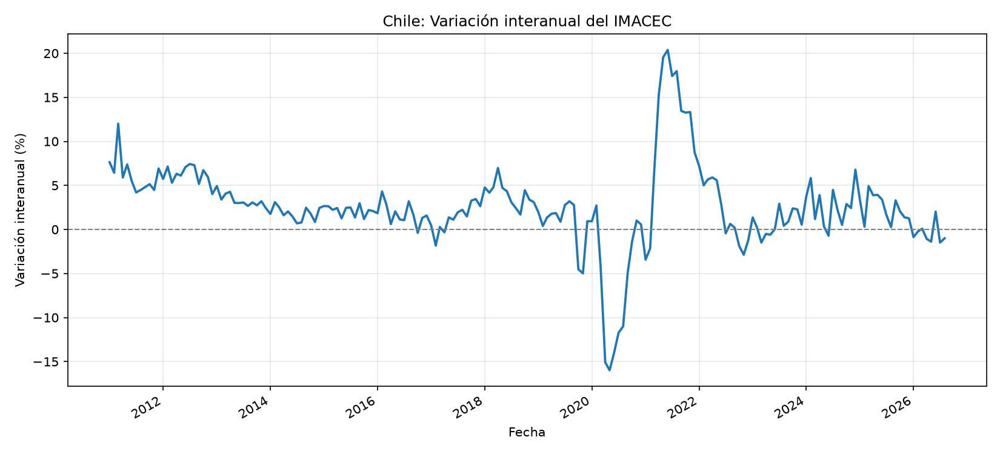
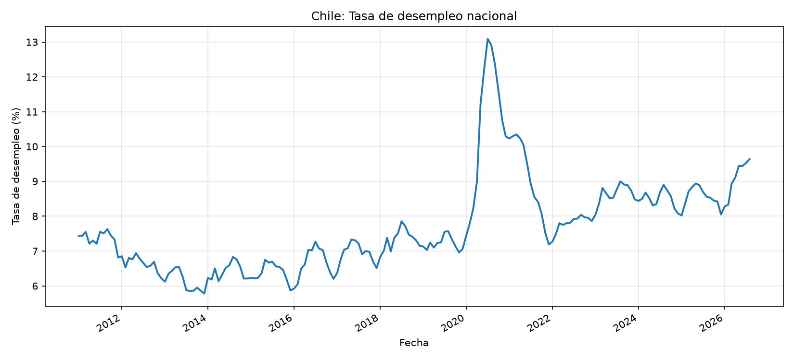
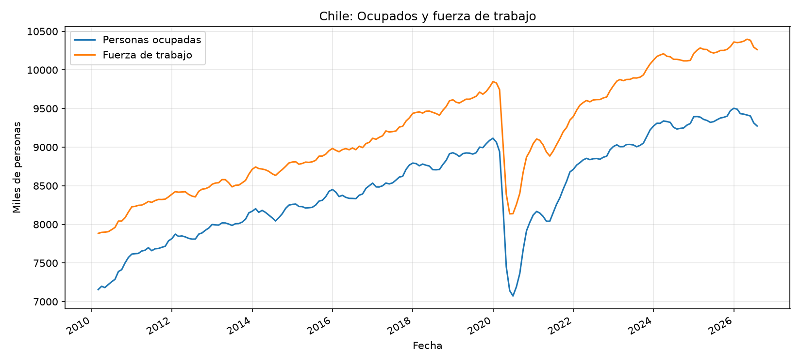
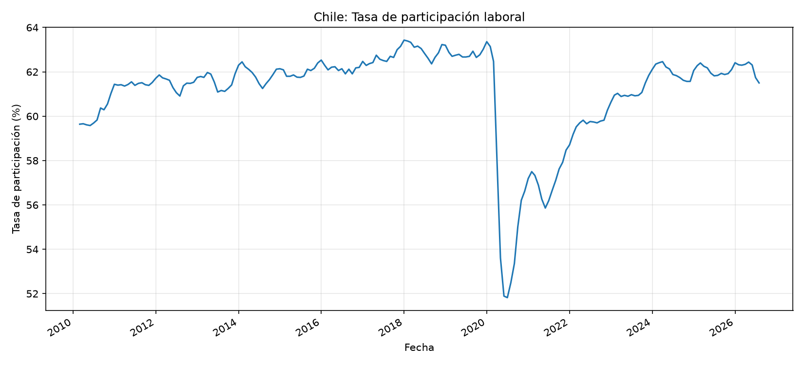
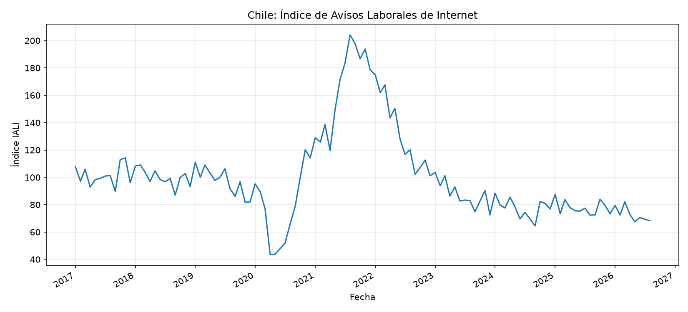
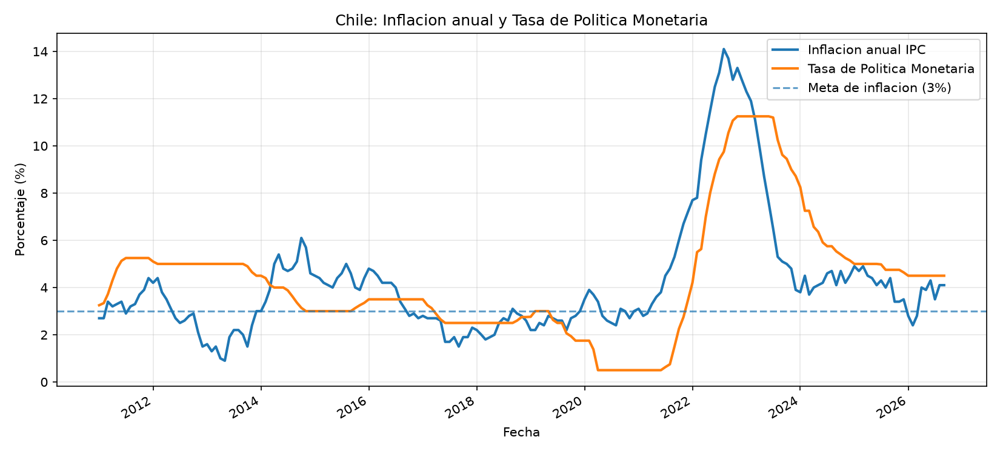
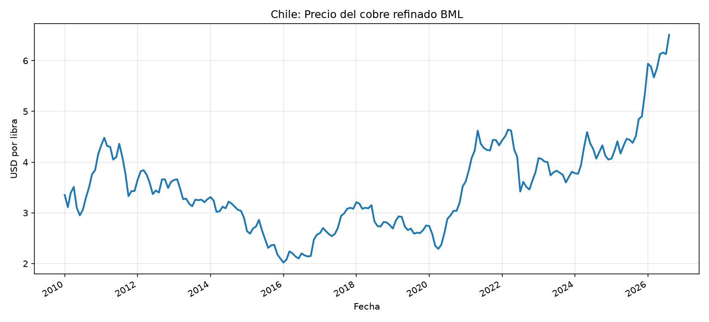
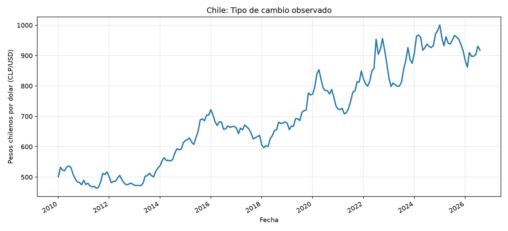
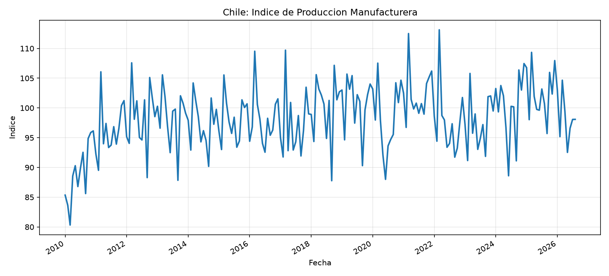
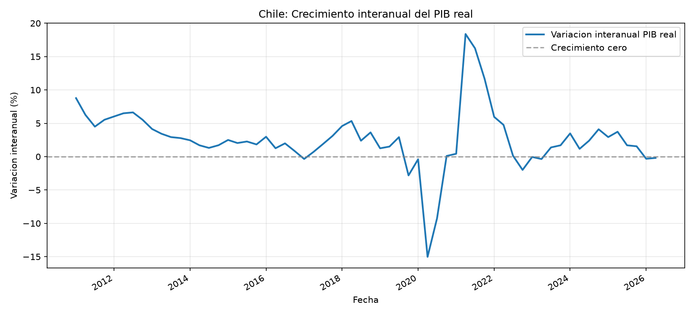

# Análisis de coyuntura económica: desempleo en Chile

## 1. Objetivo

El presente análisis tiene como objetivo examinar la evolución de la tasa de desempleo nacional en Chile y su relación con distintos indicadores macroeconómicos, utilizando información obtenida mediante la API de la Base de Datos Estadísticos (BDE) del Banco Central de Chile.

El análisis busca proporcionar una caracterización del contexto económico que permita complementar la modelación y proyección de la tasa de desempleo nacional a un horizonte de 12 meses.

Se consideran indicadores relacionados con:

- Mercado laboral.
- Actividad económica.
- Inflación.
- Política monetaria.
- Sector externo.

El análisis tiene carácter descriptivo y exploratorio. Las asociaciones identificadas no constituyen evidencia de causalidad.

## 2. Datos y metodología

### 2.1. Fuente de información

Las series económicas utilizadas provienen de la Base de Datos Estadísticos del Banco Central de Chile, mediante la API Siete.

La información se almacena en una base de datos relacional SQLite, organizada en tres tablas:

- `temas`.
- `series`.
- `observaciones`.

La base utilizada para elaborar el análisis contiene 12 series económicas y 2.167 observaciones.

La mayor parte de las series presenta frecuencia mensual, mientras que el PIB real presenta frecuencia trimestral.

### 2.2. Indicadores económicos

| Indicador | Frecuencia | Observaciones |
|---|---|---:|
| Tasa de desempleo nacional | Mensual | 198 |
| Personas ocupadas | Mensual | 198 |
| Fuerza de trabajo | Mensual | 198 |
| Población de 15 años y más | Mensual | 198 |
| IMACEC total | Mensual | 200 |
| Índice de Avisos Laborales de Internet | Mensual | 117 |
| Índice de Producción Manufacturera | Mensual | 200 |
| Inflación IPC anual | Mensual | 189 |
| Tasa de Política Monetaria | Mensual | 201 |
| Precio del cobre refinado BML | Mensual | 201 |
| Tipo de cambio observado | Mensual | 201 |
| PIB total real | Trimestral | 66 |
| **Total** | | **2.167** |

La tasa de participación laboral se calcula utilizando las series de fuerza de trabajo y población de 15 años y más.

No corresponde a una serie adicional almacenada directamente en la base de datos.

### 2.3. Cobertura temporal

La variable objetivo comprende el período entre marzo de 2010 y agosto de 2026.

Algunos indicadores complementarios contienen observaciones hasta septiembre de 2026.

Las diferencias en las fechas finales deben considerarse al realizar comparaciones entre variables.

La fecha de observación de una serie no necesariamente coincide con su fecha efectiva de publicación.

### 2.4. Transformaciones de las variables

Para estudiar la relación entre actividad económica y desempleo se utiliza la variación interanual del IMACEC y el cambio interanual de la tasa de desempleo.

La variación interanual del IMACEC se calcula como:

Crecimiento IMACEC(t) = 100 * [IMACEC(t) / IMACEC(t-12) - 1]

El cambio interanual de la tasa de desempleo se calcula como:

Cambio desempleo(t) = Desempleo(t) - Desempleo(t-12)

El crecimiento del IMACEC se expresa en porcentaje, mientras que el cambio de la tasa de desempleo se expresa en puntos porcentuales.

Mediante consultas SQL con funciones de ventana `LAG()` se construyen rezagos temporales de los indicadores.

Estas transformaciones permiten examinar posibles asociaciones entre cambios en la actividad económica y movimientos posteriores del desempleo.

### 2.5. Calidad e integridad de los datos

Durante las correcciones del Hito 3 se incorporó un procedimiento de auditoría de integridad de la base SQLite.

Los controles realizados identificaron:

- Cero violaciones de claves foráneas.
- Cero grupos de observaciones duplicadas.
- Cero observaciones con datos nulos.
- Cero observaciones sin serie asociada.
- Cero valores almacenados como no numéricos.
- Cero fechas inválidas o ausentes.
- Cero períodos faltantes dentro de la cobertura temporal de cada serie.
- Cero valores fuera de los rangos definidos en los controles aplicados.

La base superó la comprobación de integridad de SQLite.

Estos resultados respaldan la consistencia interna de la base, pero no certifican por sí solos la exactitud económica de todos los valores ni su disponibilidad histórica en tiempo real.

## 3. Evolución de la actividad económica y el desempleo

Durante el período anterior a la pandemia, la actividad económica y el mercado laboral experimentaron fluctuaciones asociadas a distintos episodios del ciclo económico.

En 2020 se produjo una contracción extraordinaria de la actividad económica, acompañada de un aumento significativo de la tasa de desempleo.

Posteriormente, durante 2021, se observó una recuperación de la actividad económica y una disminución progresiva del desempleo.

En agosto de 2026, según la base utilizada para el análisis, la variación interanual del IMACEC alcanzó -1,01%, mientras que la tasa de desempleo nacional registró un 9,64%.

La coexistencia de una contracción interanual de la actividad económica y una tasa de desempleo relativamente elevada constituye una señal de debilidad económica al cierre de la muestra común utilizada.

No obstante, esta observación no permite establecer que la contracción de la actividad económica sea la causa exclusiva del nivel de desempleo observado.

## 4. Análisis de correlaciones y rezagos

### 4.1. Metodología

El análisis exploratorio inicial considera correlaciones de Pearson entre el crecimiento interanual del IMACEC y el cambio interanual de la tasa de desempleo.

Se evalúan, entre otros, rezagos de 3, 6 y 12 meses del crecimiento del IMACEC.

Para garantizar la comparabilidad del análisis inicial se utiliza una muestra común de 176 observaciones.

Adicionalmente, se realiza una prueba de sensibilidad excluyendo el período comprendido entre 2020 y 2022, obteniendo una muestra de 140 observaciones.

### 4.2. Resultados

El análisis inicial identifica una asociación inversa entre el crecimiento económico y los cambios en el desempleo.

| Muestra | Observaciones | Rezago destacado | Correlación |
|---|---:|---:|---:|
| Muestra común | 176 | 3 meses | -0,8577 |
| Excluyendo 2020–2022 | 140 | 3 meses | -0,5795 |

En la muestra común, el crecimiento del IMACEC rezagado tres meses presenta una correlación negativa de magnitud elevada con el cambio interanual de la tasa de desempleo.

Al excluir el período 2020–2022, la correlación disminuye considerablemente en magnitud, aunque mantiene su signo negativo.

Este resultado evidencia la sensibilidad de las correlaciones a la inclusión de episodios económicos extraordinarios.

La persistencia de una asociación negativa en ambas muestras es compatible con una respuesta rezagada del mercado laboral frente a los cambios en la actividad económica.

Sin embargo, no permite establecer causalidad ni garantizar capacidad predictiva fuera de muestra.

### 4.3. Relación con la modelación predictiva

El rezago de tres meses corresponde a un resultado del análisis exploratorio inicial de correlaciones.

Por otra parte, la configuración Ridge seleccionada durante la optimización predictiva utiliza un rezago de dos meses para el IMACEC.

Ambos resultados responden a criterios metodológicos diferentes.

El análisis de correlaciones evalúa asociaciones bivariadas, mientras que la optimización de Ridge considera el desempeño predictivo de una especificación que incorpora múltiples variables.

Por esta razón, el rezago que maximiza una correlación no necesariamente coincide con aquel que minimiza el error de predicción de un modelo multivariado.

## 5. Análisis del mercado laboral

### 5.1. Ocupación y fuerza de trabajo

Durante el período 2010–2019, las series de ocupación y fuerza de trabajo presentaron una tendencia creciente.

Durante 2020 se produjo una contracción extraordinaria de ambas variables, acompañada de una disminución de la participación laboral.

Posteriormente, se observó una recuperación gradual, aunque con diferencias en la evolución de los distintos indicadores laborales.

En agosto de 2026, la ocupación se situó en aproximadamente 9,27 millones de personas, mientras que la tasa de desempleo nacional alcanzó un 9,64%.

La evolución conjunta de estas variables permite distinguir entre cambios en el desempleo asociados a variaciones de la ocupación y aquellos relacionados con modificaciones de la fuerza de trabajo.

### 5.2. Tasa de participación laboral

La tasa de participación laboral se calcula como:

Tasa de participación = 100 * Fuerza de trabajo / Población de 15 años y más

Este indicador representa la proporción de la población de 15 años y más que participa en el mercado laboral.

En agosto de 2026, la tasa de participación laboral alcanzó aproximadamente un 61,50%.

Su análisis resulta relevante debido a que una reducción de la tasa de desempleo no necesariamente implica una mejora del mercado laboral si se encuentra acompañada de una disminución de la participación.

Por esta razón, resulta conveniente interpretar conjuntamente la ocupación, el desempleo y la participación laboral.

### 5.3. Índice de Avisos Laborales de Internet

El Índice de Avisos Laborales de Internet (IALI) permite caracterizar la evolución de los avisos de empleo publicados por internet.

Durante 2021 presentó un crecimiento extraordinario, seguido de una tendencia descendente.

En agosto de 2026 registró 68,31 puntos, situándose considerablemente por debajo de los máximos observados durante la recuperación posterior a la pandemia.

Este comportamiento sugiere un menor dinamismo de los avisos laborales en comparación con dicho período.

Desde la perspectiva predictiva, el IALI constituye un indicador potencialmente relevante, debido a que los cambios en la publicación de ofertas laborales podrían anticipar modificaciones posteriores en la contratación.

No obstante, los avisos publicados no equivalen directamente a puestos de trabajo efectivamente creados.

### 5.4. Consideraciones metodológicas del mercado laboral

Las estadísticas laborales mensuales utilizadas corresponden a trimestres móviles superpuestos.

Por consiguiente, dos observaciones consecutivas comparten parte del período de referencia.

Esta característica debe considerarse al interpretar las variaciones mensuales, la persistencia de las series y su estructura de autocorrelación.

Asimismo, existe una relación contable entre ocupación, fuerza de trabajo y desempleo.

La utilización de estas variables como predictores contemporáneos puede introducir relaciones mecánicas con la variable objetivo o problemas de disponibilidad de información.

Por esta razón, su incorporación a modelos predictivos requiere un tratamiento temporal adecuado.

## 6. Inflación y política monetaria

### 6.1. Evolución histórica

El análisis considera la inflación anual medida por el IPC y la Tasa de Política Monetaria (TPM).

La muestra común comprende 189 observaciones mensuales entre enero de 2011 y septiembre de 2026.

Durante el período 2011–2019, la inflación presentó fluctuaciones relativamente moderadas en torno a la meta del Banco Central de Chile.

Durante 2020, la TPM disminuyó considerablemente en el contexto de la pandemia.

Posteriormente, durante 2021 y 2022, la economía chilena experimentó un aumento importante de las presiones inflacionarias, alcanzando niveles cercanos al 14% anual.

En respuesta a estas condiciones, el Banco Central implementó un ciclo de incrementos de la TPM, seguido posteriormente de reducciones.

### 6.2. Coyuntura al cierre de la muestra

Durante 2024–2026 se observa una reducción de la TPM respecto de los máximos alcanzados durante el período de elevada inflación.

En septiembre de 2026, según los datos almacenados en la base utilizada, la inflación anual registró un 4,1%, mientras que la TPM se situó en 4,50%.

La inflación se encontraba 1,1 puntos porcentuales por encima de la meta del 3%.

Por otra parte, la última tasa de desempleo almacenada corresponde a agosto de 2026, cuando alcanzó un 9,64%.

Estas cifras corresponden a períodos de observación diferentes y no deben interpretarse como una comparación estrictamente contemporánea.

### 6.3. Relación económica con el desempleo

La política monetaria puede influir indirectamente sobre el mercado laboral mediante sus efectos sobre:

- El costo del financiamiento.
- El consumo de los hogares.
- La inversión empresarial.
- La demanda agregada.
- Las decisiones de producción y contratación.

Un aumento de las tasas de interés puede contribuir a moderar la actividad económica y afectar posteriormente las decisiones de contratación.

No obstante, estos mecanismos suelen operar con rezagos y dependen de las condiciones económicas existentes.

La incorporación de la TPM y la inflación al análisis permite contextualizar el entorno macroeconómico, aunque su capacidad predictiva debe evaluarse empíricamente.

### 6.4. Tratamiento de la TPM

El procedimiento de descarga contempla la obtención de observaciones diarias de la TPM y el cálculo de su promedio mensual cuando la serie mensual directa no se encuentra disponible mediante el mecanismo utilizado.

La comparación entre la base original y los datos descargados identificó diferencias que son compatibles con distintos niveles de precisión numérica y métodos de agregación.

Estas diferencias no deben interpretarse automáticamente como revisiones oficiales de política monetaria.

El procedimiento utiliza las observaciones diarias disponibles y no certifica por sí solo su cobertura diaria completa.

## 7. Sector externo y actividad económica complementaria

### 7.1. Precio del cobre

Durante el período 2010–2026, el precio del cobre presentó fluctuaciones importantes asociadas a los ciclos económicos y las condiciones internacionales.

Entre 2011 y 2016 se observó una disminución significativa, seguida de períodos de recuperación.

Durante 2024–2026 se identifica una tendencia ascendente, alcanzando aproximadamente 6,51 dólares por libra en agosto de 2026.

Para la economía chilena, el cobre constituye un producto de exportación relevante.

Sus variaciones pueden influir en los ingresos de exportación, la inversión minera, la actividad económica y, de manera indirecta, en las condiciones del mercado laboral.

Sin embargo, un aumento del precio del cobre no necesariamente implica una reducción inmediata del desempleo nacional.

### 7.2. Tipo de cambio

El tipo de cambio observado presentó una tendencia de aumento durante buena parte del período 2010–2026, aunque con fluctuaciones significativas.

En agosto de 2026 alcanzó 917,66 pesos por dólar, registrando una disminución respecto de los 930,97 pesos observados en julio.

Este movimiento corresponde a una apreciación mensual del peso chileno frente al dólar.

Las variaciones del tipo de cambio pueden afectar:

- La competitividad de las exportaciones.
- Los costos de los productos importados.
- Las decisiones de inversión.
- Los costos de producción empresarial.

Su efecto sobre el empleo depende de la exposición de cada sector económico y de las condiciones macroeconómicas existentes.

### 7.3. Producción manufacturera

El Índice de Producción Manufacturera presenta fluctuaciones mensuales importantes a lo largo del período analizado.

En agosto de 2026 registró 98,08 puntos en la base utilizada, manteniéndose prácticamente estable respecto de julio, cuando alcanzó 98,07 puntos.

La actividad manufacturera permite aproximar la evolución de la producción industrial y contextualizar la demanda de trabajo de determinados sectores económicos.

No obstante, las fluctuaciones mensuales del índice pueden estar influenciadas por factores estacionales.

Por esta razón, las comparaciones de corto plazo deben interpretarse con cautela y complementarse, cuando corresponda, con variaciones interanuales o indicadores desestacionalizados.

### 7.4. PIB real trimestral

El análisis del PIB real comprende 66 observaciones trimestrales entre el primer trimestre de 2010 y el segundo trimestre de 2026.

A partir de esta información se calcularon 62 variaciones interanuales.

Durante 2011–2019 se observaron tasas de crecimiento predominantemente positivas.

Posteriormente, durante 2020, se produjo una contracción extraordinaria de la actividad económica, seguida de una recuperación significativa en 2021.

Según la base utilizada para el análisis, el PIB real registró las siguientes variaciones interanuales:

| Período | Variación interanual |
|---|---:|
| Primer trimestre de 2026 | -0,32% |
| Segundo trimestre de 2026 | -0,19% |

Estas cifras representan señales de debilidad de la actividad económica respecto de los mismos trimestres del año anterior.

Sin embargo, no permiten concluir por sí solas que la economía se encuentre en una recesión técnica, cuya evaluación requiere examinar la evolución trimestral desestacionalizada del PIB.

La frecuencia trimestral de esta variable también exige un tratamiento específico antes de incorporarla a una modelación mensual del desempleo.

## 8. Síntesis de coyuntura económica

Los resultados descriptivos obtenidos permiten identificar un escenario caracterizado por:

- Una tasa de desempleo nacional cercana al 9,64%.
- Una variación interanual negativa del IMACEC en agosto de 2026.
- Un menor dinamismo de los avisos laborales respecto de los máximos posteriores a la pandemia.
- Una inflación superior a la meta del Banco Central en septiembre de 2026.
- Una TPM inferior a los máximos registrados durante el período de elevada inflación.
- Un precio del cobre elevado respecto de buena parte de su trayectoria histórica.
- Variaciones interanuales negativas del PIB real durante los primeros dos trimestres de 2026, según la base utilizada.

La coexistencia de condiciones externas favorables en algunos indicadores y señales de debilidad en la actividad interna refleja la complejidad de las relaciones macroeconómicas.

La evolución del desempleo no puede explicarse exclusivamente mediante un único indicador.

Por ello, el monitor incorpora diferentes dimensiones económicas que permiten complementar la interpretación de los resultados predictivos.

## 9. Relación con los resultados de modelación

El análisis exploratorio permitió identificar asociaciones económicas que justifican el estudio de distintos indicadores macroeconómicos como potenciales predictores del desempleo.

Durante el Hito 3 se evaluaron las siguientes alternativas:

- Benchmark ingenuo.
- ARIMA(1,1,1).
- ARIMA(0,1,2).
- Regresión Ridge con predictores macroeconómicos rezagados.

### 9.1. Evaluación a un mes

La evaluación retrospectiva comprende 32 pronósticos por modelo entre enero de 2024 y agosto de 2026.

| Modelo | RMSE | MAE |
|---|---:|---:|
| ARIMA(0,1,2) | 0,1755 | 0,1394 |
| ARIMA(1,1,1) | 0,2076 | 0,1583 |
| Benchmark ingenuo | 0,2180 | 0,1724 |
| Ridge, alpha = 1 | 1,2985 | 1,1219 |

Los resultados muestran que ARIMA(0,1,2) obtiene el menor error predictivo a un mes.

La incorporación de predictores macroeconómicos mediante la configuración Ridge evaluada no mejora el desempeño respecto de los modelos univariados.

Esto demuestra la importancia de distinguir entre relevancia económica, asociación estadística y capacidad predictiva observada.

Una variable económicamente relevante no necesariamente mejora la precisión de un modelo de pronóstico bajo cualquier especificación.

### 9.2. Evaluación a 12 meses

| Modelo | RMSE |
|---|---:|
| Benchmark ingenuo | 0,4337 |
| ARIMA(0,1,2) | 0,5230 |
| ARIMA(1,1,1) | 0,5338 |

El benchmark ingenuo obtiene el menor RMSE entre los tres modelos evaluados a 12 meses.

En consecuencia, se selecciona como escenario central de la proyección para el horizonte objetivo del proyecto.

ARIMA(0,1,2) se mantiene como alternativa econométrica, considerando su desempeño a corto plazo.

Ridge no forma parte de esta comparación a 12 meses, por lo que no se establece una conclusión sobre su desempeño relativo en dicho horizonte.

### 9.3. Implicancias económicas

La selección del benchmark ingenuo no implica que los indicadores macroeconómicos carezcan de relevancia para comprender la evolución del desempleo.

El análisis de coyuntura continúa siendo útil para:

- Contextualizar las proyecciones.
- Identificar posibles riesgos económicos.
- Examinar cambios en las condiciones del mercado laboral.
- Interpretar acontecimientos que los modelos univariados no incorporan directamente.
- Orientar futuras especificaciones predictivas.

La interpretación detallada del pronóstico se encuentra en:

[Interpretación económica del pronóstico](interpretacion_pronostico.md)

## 10. Revisiones y reproducibilidad de los datos

### 10.1. Contraste con la fuente oficial

Durante las correcciones del proyecto se verificaron las series almacenadas mediante nuevas consultas a la API del Banco Central de Chile.

Para la tasa de desempleo nacional se comprobaron 198 observaciones correspondientes al período entre marzo de 2010 y agosto de 2026.

Todas coincidieron con los valores almacenados dentro de la tolerancia numérica utilizada.

Para el IMACEC se compararon 200 observaciones correspondientes al período entre enero de 2010 y agosto de 2026.

De ellas:

- 192 observaciones coincidieron.
- 8 observaciones presentaron diferencias.

La diferencia absoluta máxima alcanzó aproximadamente 0,447825 puntos del índice.

Las diferencias identificadas corresponden a observaciones entre enero y agosto de 2026.

La simulación de carga de las 12 series también identificó discrepancias en producción manufacturera, TPM y PIB real.

### 10.2. Preservación de la muestra original

La base utilizada para elaborar los resultados del proyecto se conserva sin modificaciones.

Esta decisión permite mantener la consistencia entre:

- El análisis de coyuntura.
- Las consultas SQL.
- Los gráficos generados.
- Las métricas de evaluación.
- Los pronósticos.
- La interpretación económica.

Por consiguiente, las cifras presentadas en este informe corresponden a la versión de los datos utilizada durante el desarrollo del proyecto y no necesariamente a la última versión disponible en la API.

### 10.3. Implicancias para la reproducción

Una nueva descarga de las series económicas puede incorporar observaciones adicionales, revisiones históricas o diferencias asociadas a la precisión y transformación de los datos.

Por esta razón, utilizar los mismos scripts y la misma fecha de corte no garantiza reproducir exactamente los resultados históricos.

La fecha de corte limita los períodos observados, pero no reconstruye las versiones de los datos disponibles en fechas anteriores.

La reproducción exacta requiere conservar una copia de la muestra utilizada y documentar las versiones de las dependencias computacionales.

## 11. Limitaciones metodológicas

### 11.1. Frecuencia de las series

La mayoría de los indicadores presenta frecuencia mensual, mientras que el PIB real presenta frecuencia trimestral.

Su integración requiere considerar las diferencias de frecuencia y disponibilidad de información.

### 11.2. Estacionalidad

Algunos indicadores presentan patrones estacionales que pueden afectar las comparaciones mensuales.

El análisis de variaciones interanuales permite reducir parte de estos efectos, aunque no sustituye necesariamente un procedimiento formal de desestacionalización.

### 11.3. Trimestres móviles

Las estadísticas laborales mensuales se construyen utilizando trimestres móviles superpuestos.

Esta característica puede generar persistencia y dependencia temporal entre observaciones consecutivas.

### 11.4. Episodios extraordinarios

La pandemia y la recuperación posterior introdujeron movimientos de magnitud excepcional en las series económicas.

Los resultados de sensibilidad muestran que estos episodios influyen considerablemente en las correlaciones estimadas.

### 11.5. Correlación y causalidad

Las correlaciones entre indicadores económicos no permiten identificar relaciones causales.

Las asociaciones pueden estar afectadas por variables omitidas, simultaneidad, autocorrelación y cambios estructurales.

### 11.6. Disponibilidad temporal

La fecha de observación de un indicador no garantiza que su valor estuviera disponible en el momento de generar un pronóstico.

El uso de rezagos busca reducir este problema, pero una evaluación estrictamente en tiempo real requiere considerar los calendarios de publicación y las versiones históricas de los datos.

### 11.7. Capacidad predictiva

El análisis descriptivo permite identificar indicadores potencialmente relevantes.

Sin embargo, su utilidad predictiva debe establecerse mediante evaluaciones fuera de muestra comparables.

Los resultados obtenidos para una determinada especificación y período no garantizan el mismo desempeño en otros contextos económicos.

## 12. Conclusiones generales

El análisis de coyuntura desarrollado inicialmente durante el Hito 2 permitió construir una caracterización de la evolución del desempleo nacional en Chile y de sus posibles relaciones con indicadores macroeconómicos.

Para ello, se utilizaron 12 series económicas y 2.167 observaciones, almacenadas en una base de datos SQLite y procesadas mediante consultas SQL y herramientas de Python.

El análisis identifica una asociación inversa entre el crecimiento del IMACEC y el cambio interanual de la tasa de desempleo.

Esta relación se mantiene al excluir el período 2020–2022, aunque con una magnitud considerablemente menor.

Los indicadores laborales, monetarios y externos permiten complementar la interpretación de las condiciones económicas asociadas a la evolución del desempleo.

Sin embargo, la evaluación predictiva realizada durante el Hito 3 muestra que la configuración Ridge considerada no mejora el desempeño a un mes respecto de los modelos univariados.

ARIMA(0,1,2) presenta el menor error predictivo a un mes, mientras que el benchmark ingenuo obtiene el menor RMSE a 12 meses entre los tres modelos evaluados en dicho horizonte.

Estos resultados muestran que una asociación económica relevante no necesariamente se traduce en una mejora de la precisión predictiva.

En consecuencia, el análisis de coyuntura y la modelación deben entenderse como componentes complementarios del proyecto.

El primero permite interpretar las condiciones macroeconómicas y del mercado laboral, mientras que el segundo proporciona una proyección estadística evaluada mediante criterios de desempeño predictivo.

Las conclusiones se encuentran condicionadas a la muestra utilizada, la especificación de los modelos y las limitaciones metodológicas identificadas.

## 13. Archivos de respaldo

### Base de datos y calidad de información

- `src/config.py`
- `base_datos/auditar_integridad.py`
- `base_datos/cargar_series.py`
- `extraccion/descargar_series.py`
- `resultados/auditoria_integridad_general.csv`
- `resultados/auditoria_integridad_series.csv`

### Análisis estadístico y predictivo

- `resultados/correlaciones_rezagos_imacec.csv`
- `resultados/metricas_comparacion_temporal.csv`
- `resultados/metricas_multihorizonte.csv`
- `resultados/pronostico_desempleo_12m.csv`

### Visualizaciones

- `graficos/03_ocupados_fuerza_trabajo.png`
- `graficos/04_tasa_participacion.png`
- `graficos/05_iali.png`
- `graficos/06_inflacion_tpm.png`
- `graficos/07_precio_cobre.png`
- `graficos/08_tipo_cambio.png`
- `graficos/09_produccion_manufacturera.png`
- `graficos/10_pib_real_trimestral.png`
- `graficos/12_evaluacion_modelos.png`
- `graficos/13_pronostico_12_meses.png`
- `graficos/16_correlaciones_rezagos.png`
- `graficos/18_evaluacion_multihorizonte.png`
- `graficos/19_diagnostico_residuos_arima_012.png`
