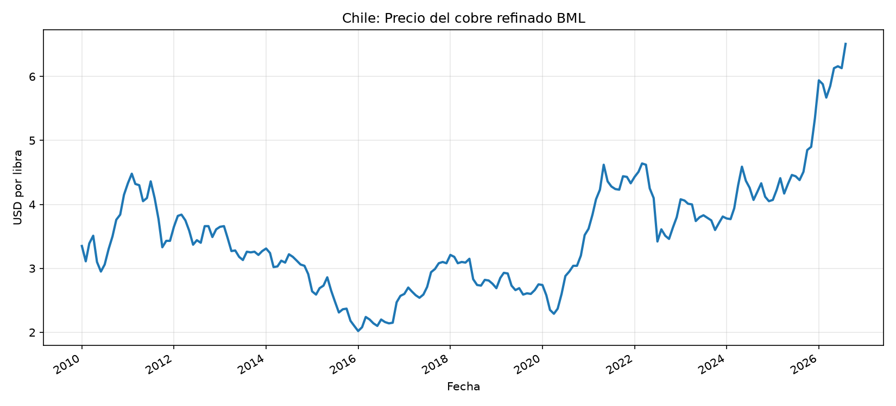
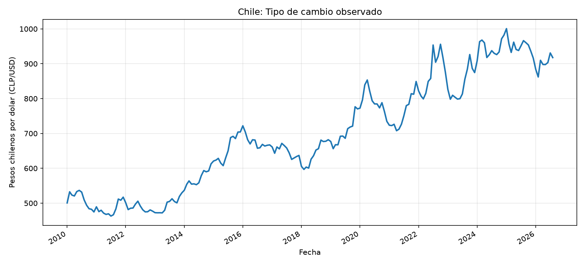
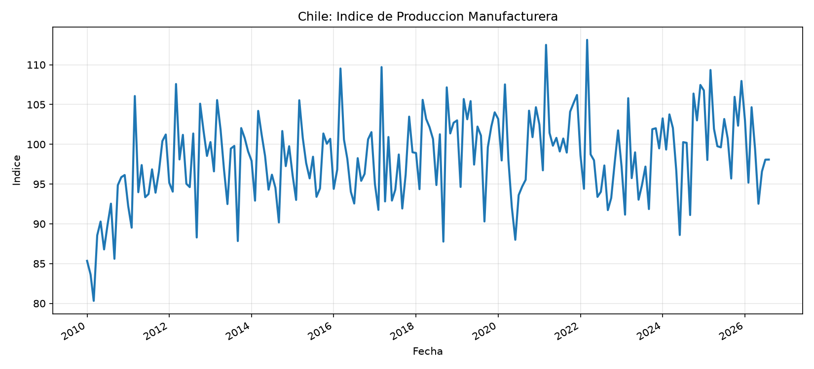
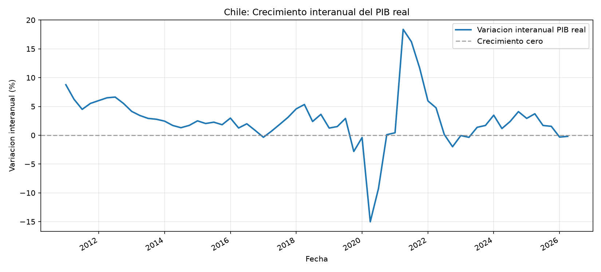

# Análisis inicial de coyuntura económica: desempleo en Chile

## 1. Objetivo

El presente análisis tiene como objetivo examinar la evolución reciente de la tasa de desempleo nacional en Chile y su relación con la actividad económica, utilizando información obtenida mediante la API de la Base de Datos Estadísticos del Banco Central de Chile.

## 2. Datos y metodología

Se construyó una base de datos SQLite que contiene 12 series económicas oficiales, con un total de 2.167 observaciones almacenadas.

Para estudiar la relación entre actividad económica y desempleo, se calculó la variación interanual del IMACEC y el cambio interanual de la tasa de desempleo, expresado en puntos porcentuales.

Mediante consultas SQL con funciones de ventana `LAG()`, se construyeron rezagos de 3, 6 y 12 meses del crecimiento del IMACEC.

Posteriormente, se calcularon correlaciones de Pearson utilizando Python y una muestra común de 176 observaciones. Como prueba de sensibilidad, se repitió el análisis excluyendo el período 2020–2022, obteniendo una muestra de 140 observaciones.

## 3. Evolución reciente de la actividad y el desempleo

Los resultados muestran que durante 2020 la actividad económica experimentó una importante contracción, acompañada de un fuerte aumento del desempleo.

Posteriormente, durante 2021, se observó una recuperación significativa de la actividad económica y una disminución progresiva del desempleo.

En agosto de 2026, la variación interanual del IMACEC alcanzó -1,01 %, mientras que la tasa de desempleo nacional registró un 9,64 %.

Estos resultados muestran un escenario de debilidad de la actividad económica y del mercado laboral al cierre del período disponible para ambas variables.

## 4. Análisis de correlaciones y rezagos

El análisis inicial identifica una asociación inversa entre el crecimiento económico y los cambios en el desempleo.

La correlación más negativa se obtiene utilizando el crecimiento del IMACEC rezagado tres meses, con un coeficiente de -0,8577 en la muestra común.

Sin embargo, al excluir el período 2020–2022, la correlación disminuye a -0,5795, lo que evidencia la influencia de los movimientos extraordinarios ocurridos durante la crisis sanitaria y su recuperación.

A pesar de esta reducción, la relación continúa siendo negativa y es compatible con una respuesta rezagada del mercado laboral frente a los cambios en la actividad económica.

## 5. Hallazgos preliminares del IMACEC y desempleo

Los resultados proporcionan evidencia descriptiva de una asociación inversa entre el crecimiento del IMACEC y la variación de la tasa de desempleo nacional.

El rezago de tres meses presenta la correlación negativa de mayor magnitud entre los períodos evaluados, tanto en la muestra completa como al excluir 2020–2022.

No obstante, las correlaciones no permiten establecer relaciones causales ni garantizar capacidad predictiva. Los resultados pueden estar afectados por factores económicos omitidos, autocorrelación y episodios extraordinarios.

En las siguientes etapas se incorporarán otros indicadores del mercado laboral, inflación, política monetaria y sector externo, junto con evaluaciones fuera de muestra para estudiar su contribución a la proyección del desempleo.

## 6. Análisis de coyuntura del mercado laboral

El análisis del mercado laboral chileno se realizó utilizando las series de tasa de desempleo, personas ocupadas, fuerza de trabajo, tasa de participación laboral e Índice de Avisos Laborales de Internet (IALI), disponibles en la Base de Datos Estadísticos del Banco Central de Chile.

Durante el período 2010–2019, las series de ocupación y fuerza de trabajo presentaron una tendencia creciente. Sin embargo, durante 2020 se produjo una contracción extraordinaria de ambas variables, acompañada de una disminución significativa de la participación laboral. Posteriormente, se observó una recuperación gradual, aunque con diferencias en la evolución de los distintos indicadores.

En agosto de 2026, la tasa de desempleo nacional alcanzó un 9,64 %, mientras que la ocupación se situó en aproximadamente 9,27 millones de personas y la tasa de participación laboral en 61,50 %. Estos resultados muestran señales de debilitamiento reciente del mercado laboral, caracterizadas por una disminución de la ocupación y de la participación, junto con un aumento del desempleo.

Por otra parte, el Índice de Avisos Laborales de Internet presentó un crecimiento extraordinario durante 2021, seguido de una tendencia descendente. En agosto de 2026 registró 68,31 puntos, lo que sugiere un menor dinamismo de los avisos de empleo en comparación con los máximos alcanzados durante la recuperación posterior a la pandemia.

Desde la perspectiva de nuestro objetivo de proyección, el IALI constituye un indicador potencialmente relevante, dado que los cambios en la publicación de ofertas laborales podrían anticipar modificaciones posteriores en la contratación y en la tasa de desempleo.

No obstante, esta relación deberá evaluarse mediante herramientas estadísticas y modelos de proyección, evitando interpretar las asociaciones observadas como evidencia de causalidad. Asimismo, las variaciones mensuales de las estadísticas laborales deben examinarse considerando que corresponden a trimestres móviles superpuestos.

## 7. Análisis de inflación y política monetaria

El análisis de inflación y política monetaria se desarrolló utilizando las series de inflación anual medida por el Índice de Precios al Consumidor (IPC) y la Tasa de Política Monetaria (TPM), obtenidas desde la Base de Datos Estadísticos del Banco Central de Chile. Se utilizaron 189 observaciones mensuales correspondientes al período comprendido entre enero de 2011 y septiembre de 2026.

### Evolución histórica de la inflación y la TPM

Durante el período 2011–2019, la inflación chilena presentó fluctuaciones relativamente moderadas, situándose en distintos momentos por encima y por debajo de la meta del 3 % establecida por el Banco Central. Durante estos años, la TPM experimentó diversos ajustes asociados a la evolución de las condiciones macroeconómicas.

Durante 2020, en el contexto de la pandemia, la TPM disminuyó considerablemente como parte de una política monetaria expansiva. Posteriormente, durante 2021 y 2022, la economía chilena enfrentó un aumento significativo de la inflación, que alcanzó niveles cercanos al 14 % anual.

Frente al aumento de las presiones inflacionarias, el Banco Central implementó un ciclo de incrementos de la TPM, que posteriormente comenzó a revertirse a medida que disminuyó la inflación.

### Coyuntura económica reciente

Durante 2024–2026 se observa una reducción de la TPM respecto de los máximos alcanzados durante el período de elevada inflación.

Sin embargo, la inflación anual ha mostrado nuevas fluctuaciones. En septiembre de 2026, la inflación registró un 4,1 %, mientras que la TPM se situó en 4,50 %. De esta manera, la inflación se encontraba 1,1 puntos porcentuales por encima de la meta del Banco Central.

Por otra parte, la última tasa de desempleo disponible en la base corresponde a agosto de 2026, cuando alcanzó un 9,64 %, evidenciando un debilitamiento reciente del mercado laboral.

### Relación potencial con el desempleo

Desde una perspectiva económica, la política monetaria puede influir sobre el mercado laboral mediante sus efectos sobre el financiamiento, el consumo, la inversión y la actividad económica.

Un aumento de las tasas de interés puede contribuir a moderar la demanda agregada y afectar las decisiones de producción y contratación de las empresas. Sin embargo, estos mecanismos suelen operar con rezagos y dependen de las condiciones económicas existentes.

Por este motivo, la TPM constituye una variable explicativa potencialmente relevante para nuestro proyecto de proyección del desempleo nacional.

No obstante, el análisis descriptivo realizado no permite establecer causalidad ni determinar la magnitud de sus efectos sobre el empleo. En etapas posteriores será necesario evaluar empíricamente si la incorporación de rezagos de la TPM y de la inflación mejora la capacidad predictiva de los modelos de desempleo.

## 8. Análisis del sector externo y actividad económica complementaria

El presente análisis incorpora cuatro indicadores adicionales seleccionados para el proyecto: precio del cobre refinado BML, tipo de cambio observado CLP/USD, Índice de Producción Manufacturera y PIB real trimestral.

Estas variables permiten complementar el estudio del desempleo nacional mediante la observación de las condiciones del sector externo, la actividad industrial y el crecimiento agregado de la economía chilena.

### 8.1. Evolución del precio del cobre

Durante el período 2010–2026, el precio del cobre presentó fluctuaciones importantes asociadas a los ciclos económicos y las condiciones del mercado internacional.

Entre 2011 y 2016 se observó una disminución significativa, seguida de períodos de recuperación. Durante 2024–2026 destaca una tendencia ascendente, alcanzando 6,51 USD por libra en agosto de 2026, el valor más elevado del período analizado.

Para la economía chilena, el cobre constituye un producto de exportación fundamental. Por ello, sus variaciones pueden influir en los ingresos de exportación, la inversión minera y la actividad económica, generando potenciales efectos indirectos sobre el mercado laboral.

Sin embargo, un aumento del precio del cobre no necesariamente implica una reducción inmediata del desempleo nacional.

### 8.2. Evolución del tipo de cambio

El tipo de cambio observado presentó una tendencia de aumento durante buena parte del período 2010–2026, aunque con importantes fluctuaciones.

En agosto de 2026 alcanzó 917,66 pesos por dólar, registrando una disminución respecto de los 930,97 pesos observados en julio. Este movimiento corresponde a una apreciación mensual del peso chileno.

Desde una perspectiva económica, las variaciones del tipo de cambio pueden afectar la competitividad de las exportaciones, los costos de los productos importados y las decisiones de inversión de las empresas.

Por lo tanto, constituye una variable potencialmente relevante para estudiar las condiciones macroeconómicas que podrían influir sobre el desempleo.

### 8.3. Producción manufacturera

El Índice de Producción Manufacturera presenta fluctuaciones mensuales importantes a lo largo del período analizado.

En agosto de 2026 registró 98,08 puntos, manteniéndose prácticamente estable respecto de julio, cuando alcanzó 98,07 puntos.

La actividad manufacturera puede aportar información sobre la evolución de la producción industrial y la demanda de trabajo de determinados sectores económicos.

No obstante, las fluctuaciones observadas pueden estar influenciadas por factores estacionales, por lo que será necesario complementar el análisis de los niveles del índice con variaciones interanuales o series desestacionalizadas.

### 8.4. Evolución del PIB real trimestral

El análisis del PIB real comprende 66 observaciones trimestrales entre el primer trimestre de 2010 y el segundo trimestre de 2026. Se calcularon 62 variaciones interanuales mediante la comparación de cada trimestre con el mismo trimestre del año anterior.

Durante 2011–2019 se observaron tasas de crecimiento predominantemente positivas. Posteriormente, la pandemia provocó una contracción importante de la actividad económica durante 2020, seguida de una recuperación significativa en 2021.

En los períodos recientes se observa una moderación del crecimiento económico. Particularmente, el PIB registró variaciones interanuales de -0,32 % en el primer trimestre de 2026 y -0,19 % en el segundo trimestre.

Estos resultados representan señales de debilitamiento de la actividad económica respecto de los mismos trimestres del año anterior. Sin embargo, no permiten concluir por sí solos que la economía se encuentre en una recesión técnica, lo cual requiere examinar las variaciones trimestrales desestacionalizadas.

### 8.5. Implicancias para la proyección del desempleo

El análisis del sector externo y de la actividad económica complementaria permite identificar indicadores que podrían aportar información para anticipar cambios en el desempleo nacional.

El precio del cobre y el tipo de cambio representan condiciones externas relevantes para una economía abierta como la chilena. Por su parte, la producción manufacturera y el PIB real permiten observar la evolución de distintos componentes de la actividad económica.

La evidencia descriptiva reciente muestra un aumento del precio del cobre y, simultáneamente, señales de debilidad en el crecimiento agregado y un incremento de la tasa de desempleo.

Esta situación evidencia que las relaciones entre las variables macroeconómicas y el desempleo pueden ser complejas y no necesariamente inmediatas.

En las siguientes etapas del proyecto será necesario evaluar estadísticamente estas relaciones, considerando posibles rezagos, diferencias de frecuencia y capacidad predictiva fuera de muestra. Particularmente, el PIB trimestral requerirá un tratamiento metodológico diferente al de los indicadores mensuales.

Los resultados descriptivos obtenidos constituyen una primera aproximación a los factores que podrían contribuir a la proyección de la tasa de desempleo nacional durante los próximos 12 meses.

## 9. Conclusiones generales del análisis inicial de coyuntura

El análisis de coyuntura desarrollado para el Hito 2 permitió construir una primera caracterización de la evolución del desempleo nacional en Chile y de sus posibles relaciones con distintas variables macroeconómicas. Para ello, se utilizaron 12 series económicas obtenidas mediante la API de la Base de Datos Estadísticos del Banco Central de Chile, almacenadas en una base de datos SQLite y procesadas mediante consultas SQL y herramientas de Python.

Los resultados muestran que el desempleo nacional responde a un entorno económico complejo, en el que intervienen factores relacionados con la actividad productiva, las condiciones del mercado laboral, la política monetaria y el sector externo.

### 9.1. Principales hallazgos

**Actividad económica y desempleo**

El análisis del IMACEC permitió identificar una asociación inversa entre el crecimiento de la actividad económica y la tasa de desempleo. Particularmente, el rezago de tres meses presentó la correlación negativa de mayor magnitud entre los rezagos evaluados.

Esta relación también se mantiene al excluir el período 2020–2022, aunque con una magnitud menor. Esto sugiere que la actividad económica puede contener información relevante para anticipar cambios en las condiciones del mercado laboral.

**Condiciones del mercado laboral**

Los indicadores laborales muestran que el desempleo nacional alcanzó un 9,64 % en agosto de 2026. Asimismo, el Índice de Avisos Laborales de Internet (IALI) presenta niveles considerablemente inferiores a los máximos observados durante la recuperación posterior a la pandemia.

Este comportamiento sugiere un menor dinamismo en los avisos de empleo, lo que podría resultar relevante para estudiar la evolución futura del desempleo.

**Inflación y política monetaria**

La inflación y la Tasa de Política Monetaria constituyen variables que permiten caracterizar las condiciones monetarias de la economía chilena.

Su potencial relación con el desempleo se encuentra vinculada a los efectos de las tasas de interés sobre el consumo, la inversión, la actividad productiva y las decisiones de contratación de las empresas.

**Sector externo y actividad productiva**

El precio del cobre y el tipo de cambio presentan fluctuaciones importantes durante el período analizado. Por otra parte, la producción manufacturera muestra una evolución mensual variable, mientras que el PIB real registra variaciones interanuales ligeramente negativas durante los primeros dos trimestres de 2026.

En conjunto, estos indicadores permiten complementar la evaluación de las condiciones económicas que podrían influir sobre el empleo nacional.

### 9.2. Relación con el objetivo del proyecto

Los resultados obtenidos permiten establecer una primera base empírica para abordar la pregunta de investigación planteada en el Hito 1: cómo evolucionará la tasa de desempleo nacional durante los próximos 12 meses y qué capacidad predictiva poseen los indicadores macroeconómicos seleccionados.

El análisis descriptivo permitió identificar variables potencialmente relevantes y posibles relaciones temporales con el desempleo. Sin embargo, todavía no se ha determinado cuáles de estos indicadores contribuyen efectivamente a mejorar las proyecciones.

Por lo tanto, los hallazgos deben interpretarse como evidencia exploratoria y no como demostraciones de causalidad o capacidad predictiva.

### 9.3. Limitaciones del análisis

El estudio presenta algunas limitaciones metodológicas que deberán considerarse en las siguientes etapas.

En primer lugar, las series económicas tienen diferentes frecuencias de observación. Mientras la mayor parte de los indicadores son mensuales, el PIB real es trimestral, por lo que su incorporación a modelos de proyección requerirá un tratamiento específico.

En segundo lugar, algunos indicadores presentan patrones estacionales y diferencias en su disponibilidad temporal. Además, las estadísticas laborales mensuales basadas en trimestres móviles contienen períodos superpuestos.

Finalmente, las asociaciones estadísticas pueden verse influenciadas por episodios económicos extraordinarios, factores omitidos y la propia dinámica temporal de las variables.
